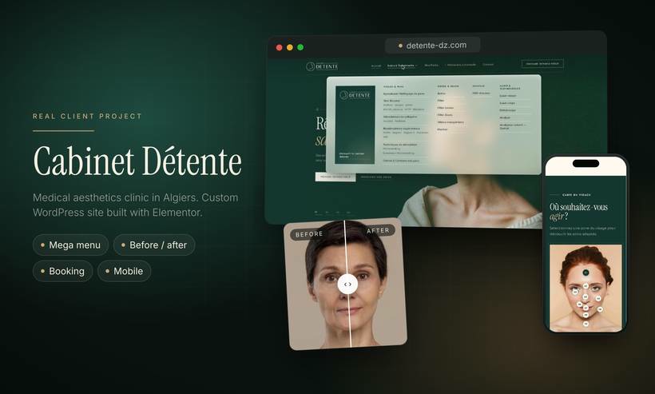
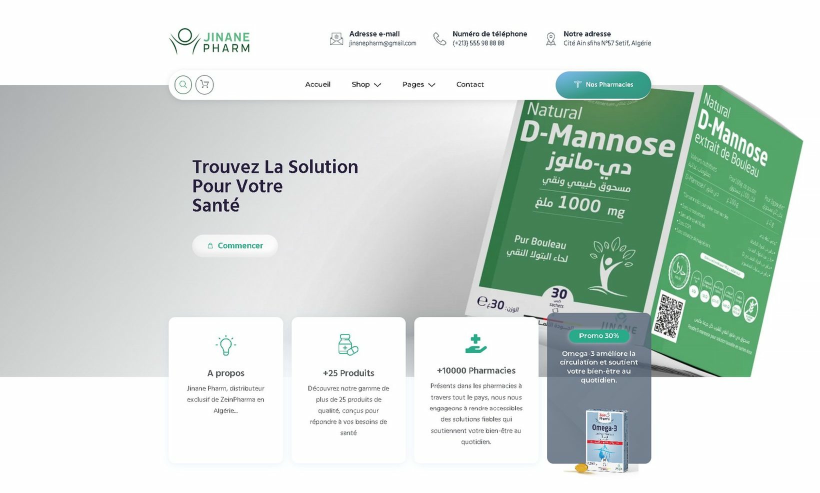

## Hi, I'm Hamza 👋

**WordPress & Elementor developer** based in Algeria, building websites for clients anywhere.

- 🎨 Figma, Lovable or AI-made designs → WordPress + Elementor
- 🌍 Multilingual websites in English, French and Arabic (RTL)
- 🛒 WooCommerce stores and product catalogs
- 🔧 Fixing, finishing and launching sites built with Lovable, Bolt and other AI tools

### Recent work

**Cabinet Détente** · medical aesthetics clinic · [detente-dz.com](https://detente-dz.com)

Custom design, a page for each treatment, an interactive face map, a before/after gallery and online booking.

**Jinane Pharm** · pharmaceutical brand · my original design (the client has since changed the live site)

WooCommerce product catalog organized by range, smooth animations and a mobile-first layout.

### Demo sites

Concept websites I built to show what I can do for restaurants and guesthouses:

- **Olive & Ember** · Mediterranean restaurant, Dubai · English and Arabic menu, online ordering, table booking · [live demo](https://hamzabkz.github.io/restaurant-demo/)
- **Riad Dar Nour** · guesthouse, Marrakech · French, English and Arabic, rooms and direct booking · [live demo](https://hamzabkz.github.io/riad-demo/)

### Tools

WordPress · Elementor (Free & Pro) · WooCommerce · Figma · HTML · CSS

### Work with me

Open to freelance projects and remote roles.

[LinkedIn](https://www.linkedin.com/in/hamzab-dev) · [Upwork](https://www.upwork.com/freelancers/~01e983105fc928e962) · [Fiverr](https://www.fiverr.com/hmza19506) · hamzab.dev@outlook.com
